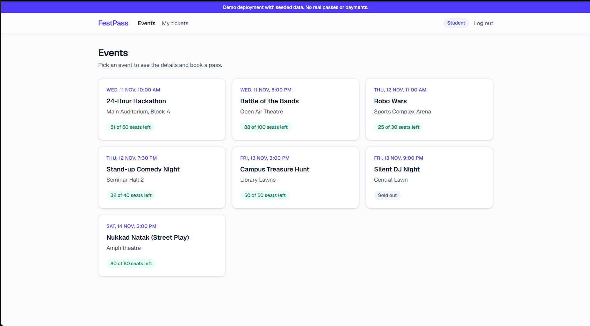
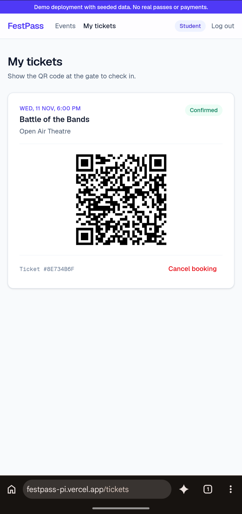
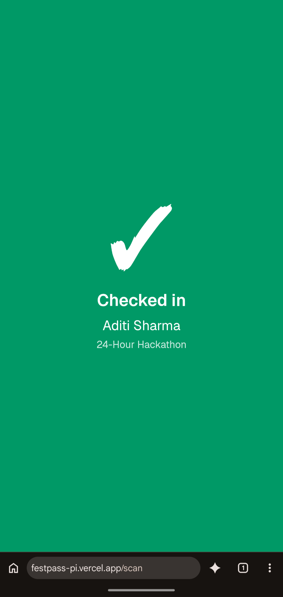
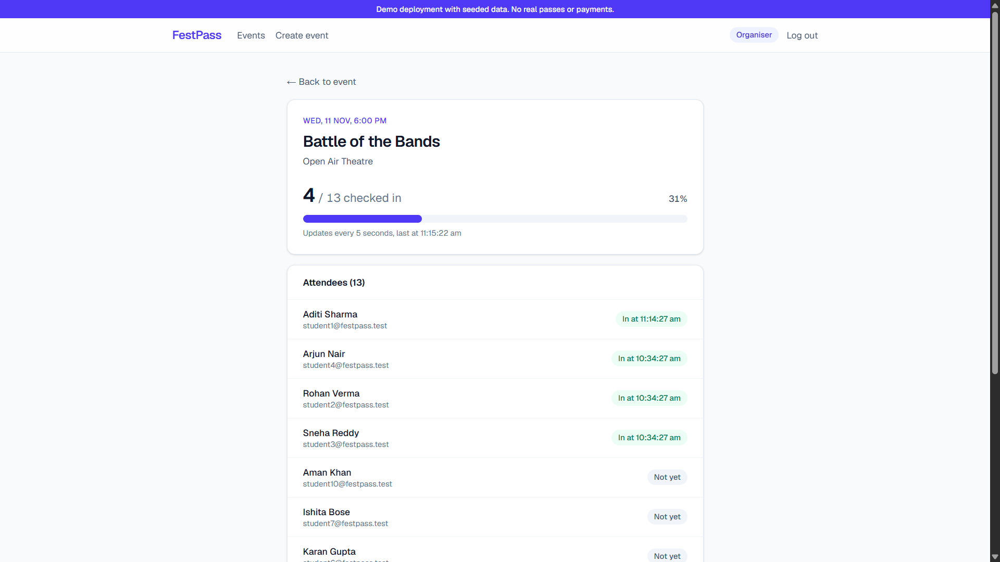
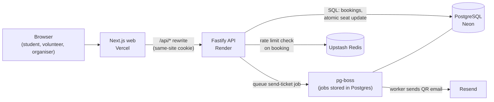
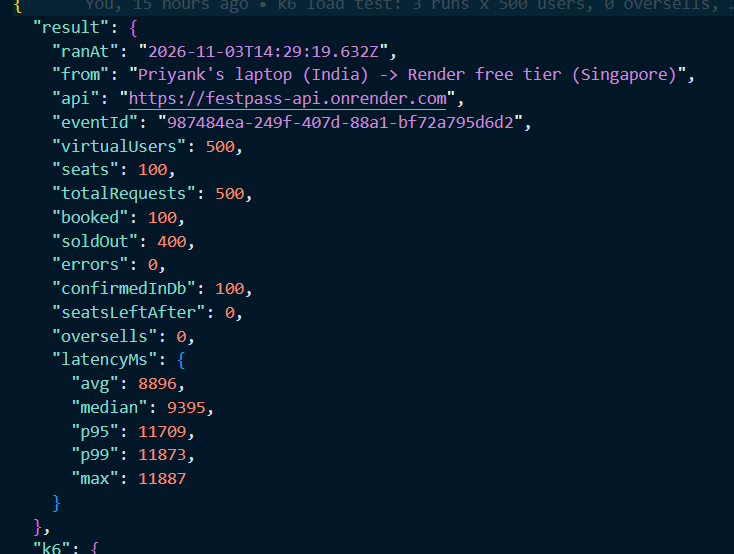

# FestPass

[](https://github.com/project-devo/festpass/actions/workflows/ci.yml)

College fest ticketing with QR check-in. Students book seats, get a signed QR ticket by email, and volunteers scan them at the gate. The core guarantee: **the last seat is never sold twice**, even when hundreds of students book at the same moment.

**Live demo:** https://festpass-pi.vercel.app (hosted on free tiers, so the first load can take up to a minute while the API wakes up)

_Demo deployment with seeded data: a fake fest ("Resonance 2026") and test users, no real money. While the API wakes up, the site shows a "waking up the server" notice and retries on its own._

## Demo logins

The login page has one-click buttons for each role, or type these in:

| Role | Email | Password | What to try |
|---|---|---|---|
| Student | student1@festpass.test | student123 | Book an event, open My tickets, cancel |
| Volunteer | volunteer1@festpass.test | volunteer123 | Open Scan and point the phone camera at a ticket QR |
| Organiser | organiser@festpass.test | organiser123 | Create an event, open View attendance |

Ticket emails in the demo all go to one inbox (Resend's free tier only delivers to the account owner), so a visitor sees their QR on the My tickets page.

## Screenshots



| QR ticket (phone) | Gate scanner (phone) |
|---|---|
|  |  |



## Architecture



- The browser only talks to Vercel. Vercel forwards `/api/*` to the Render API, so the login cookie is first-party (this fixed Safari dropping a cross-site cookie).
- Booking commits in Postgres first, then queues a `send-ticket` job. A worker in the same API process draws the QR and emails it, retrying 3 times with backoff, so a slow email never slows or breaks booking.
- Upstash Redis holds the rate-limit counters. If Redis is down, booking still works (the limiter fails open).

## Features

- Booking that can't oversell (one atomic Postgres update per booking)
- Signed QR tickets (booking id + HMAC), cancel gives the seat back
- Ticket emails with the QR code, sent by a background job (pg-boss) with retries
- Volunteer scanner page (phone camera); a second scan of the same ticket is refused
- Attendance page for organisers, refreshing every 5 seconds
- Rate limiting on booking with Upstash Redis (5 per minute per student, 30 per IP), 429 with Retry-After
- CI on every push (GitHub Actions): lint, type-check, 14 Vitest tests against a Postgres service container, and a k6 smoke test (50 students, 10 seats, 0 oversells) against the API started inside the job

## How booking stays safe

Each booking runs one transaction that starts with
`UPDATE events SET seats_left = seats_left - 1 WHERE id = $1 AND seats_left > 0 RETURNING seats_left`.
Postgres locks the event row, so a second request waits and re-checks `seats_left > 0` on the new value; if no row comes back, the answer is 409 Sold out. A "read seats, then write" version oversells under load because two requests can both read 1 seat left. A `CHECK (seats_left >= 0)` constraint and a unique index on active bookings are the last line of defence.

## Load test (k6)

500 virtual users each sent one booking at the same moment to a fresh 100-seat event on the live API. Run from my laptop (India) to Render free tier and Neon (Singapore), 2026-11-03.

| Run | Requests | Booked | Sold out | Errors | Oversells | p95 |
|---|---|---|---|---|---|---|
| 1 | 500 | 100 | 400 | 0 | 0 | 14.4 s |
| 2 | 500 | 100 | 400 | 0 | 0 | 11.7 s |
| 3 | 500 | 100 | 400 | 0 | 0 | 10.3 s |

**0 oversells and 0 errors across 1,500 concurrent requests.** Latency is high because the free instance has a fraction of a CPU and a 10-connection database pool, so 500 simultaneous bookings queue; the test proves correctness, not speed. The test also found a real bug (Render to Neon connections timing out under load), fixed in `api/src/server.ts`. Script: `api/loadtest/book.js`, results: `api/loadtest/results/`, details in [NOTES.md](NOTES.md).



## Stack

| Part | Tech |
|---|---|
| Web | Next.js 16, TypeScript, Tailwind CSS (Vercel) |
| API | Node.js, Fastify 5, Zod, JWT in an httpOnly cookie (Render) |
| Database | PostgreSQL on Neon, Drizzle ORM and migrations |
| Background jobs | pg-boss (queue stored in Postgres) |
| Rate limiting | Upstash Redis, sliding window |
| Email and QR | Resend, qrcode (draw), html5-qrcode (scan) |
| Testing | Vitest + Fastify inject, k6, GitHub Actions |

## Project structure

```
api/              Fastify API
  src/routes/     auth, events, booking, me (tickets, cancel), checkin, attendance
  src/db/         Drizzle schema, client, seed
  drizzle/        SQL migrations
  test/           Vitest integration tests
  loadtest/       k6 script, load-test user seeding, saved results
web/              Next.js app (src/app = pages, src/components, src/lib/api.ts)
docs/screenshots/ README images
NOTES.md          design decisions and every measured number
```

## Run locally

You need **Node 22.12 or newer**, **pnpm** (`npm install -g pnpm`), and a **PostgreSQL 16** database. Email and Redis are optional.

**1. Clone and install**

```
git clone https://github.com/project-devo/festpass.git
cd festpass
pnpm install
```

**2. Get a database.** Either create a free project on [Neon](https://neon.tech) and copy its connection string, or run Postgres in Docker:

```
docker run -d --name festpass-db -e POSTGRES_PASSWORD=postgres -e POSTGRES_DB=festpass -p 5432:5432 postgres:16
```

**3. Create `api/.env`** by copying `api/.env.example`. The defaults already match the Docker database above. For Neon, replace `DATABASE_URL` with your Neon string. Change `JWT_SECRET` and `QR_SECRET` to any two long random strings.

| Variable | Needed? | What it is |
|---|---|---|
| `DATABASE_URL` | Yes | Postgres connection string |
| `JWT_SECRET`, `QR_SECRET` | Yes | Secrets for login tokens and QR signatures |
| `RESEND_API_KEY` | Yes, any value | A real [Resend](https://resend.com) key sends ticket emails; a placeholder lets the API start (email jobs fail and are logged, booking still works) |
| `TICKET_EMAIL_TO` | No | Send every ticket to this address (Resend free only delivers to your own email) |
| `RATE_LIMIT` | No | `off` skips rate limiting; remove it and set the two `UPSTASH_REDIS_REST_*` values to turn it on |
| `WEB_ORIGIN` | No | Web URL allowed by CORS, default `http://localhost:3000` |

**4. Create the tables and the demo data**

```
pnpm --filter api db:migrate
```

```
pnpm --filter api db:seed
```

**5. Start the API** (port 4000)

```
pnpm --filter api dev
```

**6. Start the web app** in a second terminal (port 3000), then open http://localhost:3000 and log in with a demo account.

```
pnpm --filter web dev
```

The web app calls `http://localhost:4000` by default, so it needs no env file locally.

## Tests

The 14 integration tests wipe every table, so they need a second, empty database. With Docker, create it inside the same container:

```
docker exec festpass-db createdb -U postgres festpass_test
```

(With Neon, create a branch or a second database instead.) Then create `api/.env.test` with four lines: `DATABASE_URL` pointing at that test database (never the one in `api/.env`), `JWT_SECRET`, `QR_SECRET`, and `ALLOW_DB_RESET=yes`. Create its tables once, then run the tests:

```
pnpm --filter api db:migrate:test
```

```
pnpm test
```

The tests mock email and Redis, so they need no Resend or Upstash keys.

Design decisions and every measured number are in [NOTES.md](NOTES.md).
